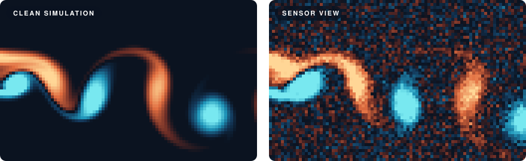

# 🌊 RealPDE 2026 — My Work on Both Tracks

<p align="center">
  <a href="https://realpdecompetition.github.io/"></a>
  <a href="https://huggingface.co/datasets/AI4Science-WestlakeU/RealPDE-Competition-Data"></a>
</p>
<p align="center">
  
  
  <a href="track1-sim2real/"></a>
  <a href="track2-test-time-adaptation/"></a>
  <a href="NOTICE"></a>
</p>

My code and notes from the [RealPDE Competition](https://realpdecompetition.github.io/) at NeurIPS 2026. The organizers took neural operators pretrained on clean fluid simulations and asked how well they hold up on **real measurements**: flow past a NACA4418 airfoil in a water tunnel, captured with particle image velocimetry (PIV).

<p align="center">
  
</p>
<p align="center">
  <sub>An illustration I generated, not competition data: the wake from a small lattice-Boltzmann simulation (left), and the same flow degraded the way PIV measurements are (right). <a href="assets/README.md">How it was made</a> · the <a href="https://realpdecompetition.github.io/#about">competition website</a> shows the real pair.</sub>
</p>

Models learn from data like the left panel, and get graded on data like the right. Both tracks use the same setup: watch 20 frames of measured velocity (u and v), then forecast the next 20. The score blends five things: field accuracy (Rel-L2), turbulent kinetic energy (TKE), the mean wake profile (MVPE), inference speed, and how honest the uncertainty bounds are (SPS).

## 🎯 The two tracks

🔀 **[Track 1: Sim-to-Real](track1-sim2real/)**
- **Task:** Forecast real PIV windows, each scored on its own, with a model that starts from simulation.
- **Starting point:** The organizers' simulation-pretrained convolutional neural operator (CNO).
- **Competition:** [Codabench 17363](https://www.codabench.org/competitions/17363/).

📡 **[Track 2: Long-Term Test-Time Adaptation](track2-test-time-adaptation/)**
- **Task:** Forecast one long, ordered real stream. After every forecast the true window is revealed, and the model may adapt to it before the next one. All state must reset between trajectories.
- **Starting point:** The organizers' simulation-pretrained Fourier neural operator (FNO).
- **Competition:** [Codabench 17385](https://www.codabench.org/competitions/17385/).

## 🛠️ What I did

| Track | Work | Best development score |
|---|---|---|
| 1 | Fine-tuned the sim CNO for 3000 updates on real flow with a scale-balanced loss. Added one small residual adapter on top, persistence for the first four frames, and calibrated intervals. | **77.31**, up from 74.84 for my first package |
| 2 | Split the FNO into mean and fluctuation heads, fine-tuned it on real flow, and adapted while streaming with two cheap running statistics instead of gradient updates. | **77.62**, up from 75.42 for my first package |

Scores are the official development-leaderboard results I recorded from Codabench, not a final private-test ranking. Each track's README has the recipe, the score journey and what didn't work. Its `EXPERIMENTS.md` lists every experiment, including the dead ends.

## 📁 Layout

```
.
├── assets/                          # the animation above + the script that makes it
├── track1-sim2real/
│   ├── src/realpde_t1/              # residual adapter, losses, training loop, validation splits
│   ├── scripts/                     # backbone training + adapter training
│   ├── configs/                     # backbone, adapter and data-split configs
│   ├── submission/                  # the submitted wrapper
│   ├── EXPERIMENTS.md
│   └── USAGE.md
└── track2-test-time-adaptation/
    ├── src/realpde_t2/              # dual-head FNO, streaming state, intervals, stream evaluator
    ├── scripts/                     # training, packaging, deployed-parity check
    ├── configs/                     # training + packaging configs, leakage-safe splits
    ├── submission/                  # the streaming wrapper
    ├── EXPERIMENTS.md
    └── USAGE.md
```

## 🚀 Setup

```bash
git clone https://github.com/pranay172/RealPDE-NeurIPS26.git
cd RealPDE-NeurIPS26
python3.10 -m venv .venv && source .venv/bin/activate
pip install torch==2.7.1 --index-url https://download.pytorch.org/whl/cu128
pip install -r requirements.txt
```

> [!IMPORTANT]
> Data, checkpoints and the organizer starter kits aren't included. Download the [competition data](https://huggingface.co/datasets/AI4Science-WestlakeU/RealPDE-Competition-Data) into `RealPDE-Competition-Data/` at the repo root, and get each track's starter kit from its Codabench page. Each track's `USAGE.md` has the exact layout and commands.

## 💡 Lessons

- **Simple and robust beat clever.** My fanciest Track 1 ensemble passed every local check and then scored 7.96 on the server. A single adapter went on to set my best score.
- **Hold out whole regimes.** Validating on unseen Reynolds-number and angle-of-attack conditions, not random windows, was what kept my local numbers honest.
- **Check what you actually loaded.** In Track 2, a loader bug left a model at random weights while its config said otherwise. I now check initialization tensor by tensor.
- **Running statistics beat test-time gradients.** In Track 2, gradient updates on each revealed window cost runtime and bought almost nothing. Two exponential moving averages did far more.

## 🙏 Acknowledgements

The data, pretrained baselines, starter kits and evaluation come from the RealPDE organizers and the [RealPDEBench](https://github.com/AI4Science-WestlakeU/RealPDEBench) team. Thanks for a genuinely interesting problem. I used AI coding assistants (OpenAI Codex/ChatGPT and Claude) for implementation, debugging, analysis and documentation.

## 📄 License

My code and documentation are released under the [MIT License](LICENSE), with one exception: two Track 2 files adapt FNO code from RealPDEBench and stay under **CC BY-NC 4.0** (non-commercial). They carry their own headers. The competition data, checkpoints and starter kits aren't included and keep their own terms. See [NOTICE](NOTICE) for details.
