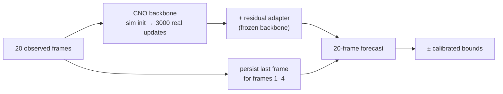

# 🔀 Track 1 — Sim-to-Real

  
  
  

**Teaching a neural operator raised on clean simulations to forecast messy, real water-tunnel flow.**

## 🎯 The task

- **Input:** 20 frames of measured velocity (u and v) on a 32 × 64 grid, from PIV in a water tunnel.
- **Output:** The next 20 frames, plus lower and upper uncertainty bounds for every value.
- **Data:** 82 real trajectories across Reynolds numbers and angles of attack. One is a duplicate (`7575_0.h5`), which leaves 81 valid ones. There are also 100 simulated trajectories.
- **Scoring:** Field accuracy (Rel-L2), turbulent kinetic energy (TKE), the mean wake profile (MVPE), inference time, and uncertainty quality (SPS), blended into one `final_score`.
- **Starting point:** The organizers' simulation-pretrained convolutional neural operator (CNO).

## 🛠️ What I did

I didn't invent a new architecture. I spent the competition working out how to adapt, correct and trust the organizers' CNO on real data. The recipe behind my best submission:

| # | Step | Why it helped |
| :-: | :--- | :--- |
| 1 | **Longer fine-tuning on real flow.** 3000 updates (up from 600) on all 81 trajectories, starting from the simulation checkpoint. | It improved all four quality subscores on two separate held-out regime splits. |
| 2 | **A scale-balanced loss.** Each window's error is divided by that window's own flow energy. | Stops fast, high-energy flows from drowning out everything else. |
| 3 | **One small correction network.** Freeze the backbone and train a zero-initialized Conv3d residual adapter, with a rollout curriculum so it practises forecasting further ahead. | Cheap, stable refinement. One adapter held up where three didn't (see below). |
| 4 | **Persistence for the first four frames.** Copy the last observed frame forward. | The next few frames look a lot like the present, and persistence is hard to beat that close in. |
| 5 | **Calibrated bounds.** `pred ± (0.025·abs(pred) + 0.15·σ)`, with σ = 0.0563870259, fitted on training data only. | SPS rewards bounds that are tight but honest. This alone was worth about +22 SPS early on. |
| 6 | **Independent samples.** No batching tricks, caching or peeking across evaluation windows. | Each prediction is the same no matter what it's evaluated alongside. |

## 📈 The journey

Official development-leaderboard scores I recorded from Codabench. They aren't a final private-test ranking or a fresh reproduction.

| # | What changed | Score |
| :--- | :--- | ---: |
| 1 | First package whose predictions don't depend on batch composition | 74.84 |
| 2 | Persistence for the first four forecast frames | 75.57 |
| 3 | A residual adapter on top of the CNO backbone | 75.87 |
| 4 | All-data training with a rollout-trained adapter | 75.88 |
| **5** | **Long-budget backbone (3000 updates) + single adapter** | **77.31** |

<b>Full score breakdown of the best submission</b>

 

| What was measured | Metric | Score |
| :--- | :--- | ---: |
| Flow-field accuracy | Rel-L2 | 94.023891 |
| Turbulent energy | TKE | 73.827351 |
| Mean wake profile | MVPE | 93.166385 |
| Inference speed | Time | 85.988280 |
| Uncertainty quality | SPS | 32.361125 |
| **Overall** | **final_score** | **77.307902** |

It improved every metric over the previous submission. Its backbone was trained on all 81 valid trajectories, so it has no clean local holdout. The held-out evidence for the recipe comes from running the same recipe on my two validation splits.

## 💡 What didn't work

- **The ensemble that fell off a cliff.** A three-adapter ensemble passed every local check, then scored **7.96** on the server. Stress tests later made it blow up on rare extreme inputs, and a review found a separate wrapper bug, so the exact cause was never pinned down. My best submission went back to a single adapter.
- **A local pass is not a server pass.** My last attempt passed local container checks and then failed evaluation. I never got the log, so the cause is unknown.
- **Wavelet losses, FiLM conditioning, heteroskedastic heads, spatial uncertainty maps.** Each got its own experiment and some helped locally, but none made it into the final recipe.
- **Validate on whole regimes.** Holding out entire Reynolds-number and angle-of-attack conditions, not random windows, kept my local numbers honest.

All 44 experiments, dead ends included, are in **[EXPERIMENTS.md](EXPERIMENTS.md)**.

## 📁 Files

| Path | What it is |
| :--- | :--- |
| [`src/realpde_t1/training.py`](src/realpde_t1/training.py) | Real-data windows, normalization statistics, the scale-balanced loss |
| [`src/realpde_t1/adapter.py`](src/realpde_t1/adapter.py) | The residual Conv3d adapter, plus the FiLM and heteroskedastic variants I tried |
| [`src/realpde_t1/validation.py`](src/realpde_t1/validation.py) | Regime-held-out splits, persistence and local scoring |
| [`src/realpde_t1/wavelet_loss.py`](src/realpde_t1/wavelet_loss.py) | Wavelet-TKE loss for one of the adapter variants |
| [`scripts/train_backbone.py`](scripts/train_backbone.py) | Trains the 3000-update all-data backbone (via `train_cno.py`) |
| [`scripts/train_adapters.py`](scripts/train_adapters.py) | Trains three adapter variants on the frozen backbone. The best submission uses the rollout-curriculum one. |
| [`configs/`](configs/) | Configs for the backbone and adapter runs, and the all-data split |
| [`submission/`](submission/) | The submitted wrapper |

## 🔁 Reproduce

See **[USAGE.md](USAGE.md)**. In short: restore the data and starter kit, train the backbone, then train the adapter.

> [!WARNING]
> Trained weights aren't included. I haven't rerun the pipeline on the real data since the competition, so treat it as the recipe rather than a guaranteed path back to 77.31.
