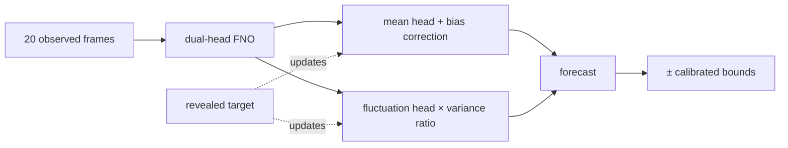

# 📡 Track 2 — Long-Term Test-Time Adaptation

<p>
  <a href="https://www.codabench.org/competitions/17385/"></a>
  
  
  
</p>

**Forecasting a live, real-world flow and learning from every measurement as it arrives.**

## 🎯 The task

Most forecasting benchmarks hand a model one window, check its answer and move on. Track 2 works more like deployment. The model watches one real, measured flow past an airfoil **as a long, ordered stream**:

```text
 observe 20 frames ─▶ forecast the next 20 ─▶ the truth is revealed ─▶ adapt ─▶ forecast again ─▶ …
```

- **Rules:** A forecast may only learn from targets that have *already* been revealed. Everything the model adapts must be wiped when a new trajectory begins.
- **Inputs:** Each revealed window becomes the next measured input. Predictions are never fed back in.
- **Scoring:** The same five parts as Track 1: Rel-L2, TKE, MVPE, Time and SPS.
- **Starting point:** The organizers' simulation-pretrained Fourier neural operator (FNO).

## 🛠️ What I did

My best submission doesn't retrain anything during the stream. I tried gradient updates on the fly and found them slow for very little gain. Instead it keeps two cheap running statistics and uses them to nudge each new forecast.

| # | Step | Details |
| :-: | :--- | :--- |
| 1 | **Split the forecast into "average" and "wiggle."** | Two output heads: one for the temporal-mean flow, one for the zero-mean fluctuations. Their sum is the forecast. Both start as copies of the simulation checkpoint's last layer, so the starting model matches the original up to rounding. I check this tensor by tensor. |
| 2 | **Fine-tune on real flow.** | 1800 updates on all 81 valid trajectories, sampling each trajectory equally so long ones don't dominate. |
| 3 | **Correct drift in the mean.** | A mean-bias EMA (decay 0.90) tracks how far off recent forecasts were on average and corrects the next one by that much. |
| 4 | **Correct the fluctuation strength.** | A per-pixel variance EMA (decay 0.90) tracks how much the real flow fluctuates. Forecast fluctuations get rescaled by that ratio, clipped to 0.2–5× and smoothed. |
| 5 | **Say how unsure it is.** | `pred ± (0.020·abs(pred) + 0.140·σ)`, with σ = 0.0563870259 the organizers' fixed scale. |
| 6 | **Reset at every trajectory boundary.** | No state, cache or statistic leaks from one trajectory to the next. |



## 📈 The journey

Official development-leaderboard scores I recorded from Codabench. They aren't a final private-test ranking or a fresh reproduction.

| # | What changed | Score |
| :--- | :--- | ---: |
| 1 | First validated streaming package | 75.42 |
| 2 | Same FNO recipe, refit on all real trajectories | 75.50 |
| 3 | Dual-head FNO with streaming mean-bias correction | 76.50 |
| 4 | Per-pixel streaming variance adaptation (TKE **+6.6** over #3) | 76.76 |
| **5** | **Verified simulation initialization + balanced sampling + longer training** | **77.62** |

<details>
<summary><b>Full score breakdown of the best submission</b></summary>
<br />

| What was measured | Metric | Score |
| :--- | :--- | ---: |
| Flow-field accuracy | Rel-L2 | 93.614317 |
| Turbulent energy | TKE | 77.141376 |
| Mean wake profile | MVPE | 93.391126 |
| Inference speed | Time | 88.185671 |
| Uncertainty quality | SPS | 32.109079 |
| **Overall** | **final_score** | **77.615784** |

It improved all four quality metrics over #4, while Time dipped slightly. It combined several changes, so one server comparison can't say which one mattered most. The streaming wrapper is the same as #4's.

</details>

## 💡 What didn't work

- **Gradient-based test-time training.** Updating the whole model, or just its last layer, on each revealed window cost runtime and bought almost nothing.
- **The initialization that wasn't.** A checkpoint-loading bug left the model behind submissions #3 and #4 at **random weights**, even though its config pointed to a real-data checkpoint. After the fix, a proper simulation initialization improved every quality metric in all four fold/seed checks. That became part of my best submission.
- **Mixing simulation into fine-tuning.** Training on simulated and real data together, without aligning them first, collapsed the TKE score.
- **Fancier uncertainty and feedback.** Learned variance heads, coverage feedback, residual feedback and input blending either failed their gates or lost to the plain variance EMA.
- **Not every failure is yours.** One submission failed because the platform couldn't fetch the organizers' ingestion bundle, before my code even ran.

All experiments, dead ends included, are in **[EXPERIMENTS.md](EXPERIMENTS.md)**.

## 📁 Files

| Path | What it is |
| :--- | :--- |
| [`src/realpde_t2/dual_head_fno.py`](src/realpde_t2/dual_head_fno.py) | The dual-head FNO and checkpoint conversion (CC BY-NC 4.0) |
| [`src/realpde_t2/streaming_state.py`](src/realpde_t2/streaming_state.py) | Streaming predictor with the mean-bias and variance EMAs |
| [`src/realpde_t2/uncertainty.py`](src/realpde_t2/uncertainty.py) | Symmetric intervals and train-only calibration |
| [`src/realpde_t2/training.py`](src/realpde_t2/training.py) | Window loading and physical u/v losses |
| [`src/realpde_t2/data_manifest.py`](src/realpde_t2/data_manifest.py) | Data audit and leakage-safe split manifests |
| [`src/realpde_t2/stream_eval.py`](src/realpde_t2/stream_eval.py) | Local streaming evaluator |
| [`scripts/train_dual_head_fno.py`](scripts/train_dual_head_fno.py) | Fine-tunes the dual-head FNO |
| [`scripts/package_submission.py`](scripts/package_submission.py) | Builds the submission zip and runs the organizer's `local_eval` on it |
| [`scripts/check_deployed_parity.py`](scripts/check_deployed_parity.py) | Checks the packaged wrapper against the research predictor |
| [`configs/`](configs/) | Training and packaging configs, plus the split manifests |
| [`submission/`](submission/) | The streaming wrapper (CC BY-NC 4.0) |

## 🔁 Reproduce

See **[USAGE.md](USAGE.md)**: restore the data and starter kit, train (about 6 minutes on an RTX 5050), then package and check.
